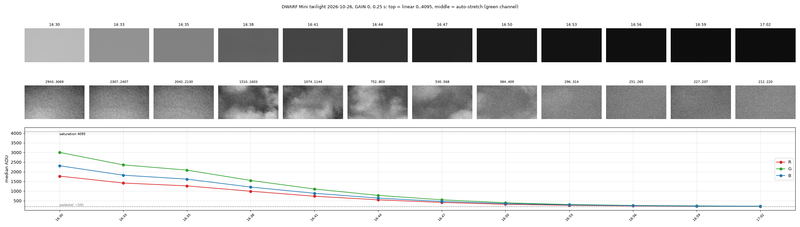

# DWARF Mini photometry notes for AAVSO

Raw data and small scripts from a DWARF Mini (30/150 mm, Sony IMX662 OSC) on a city balcony in Dnipro, Ukraine.
Observer code **KTFA**. Collected for the AAVSO Smart Telescope Working Group (STWG) and for my own
variable-star photometry. Free to use, please credit the data.

## Contents

| Path | What |
|---|---|
| `gain/ptc_gain.py` | Photon-transfer gain estimate per Bayer channel (R, G1, G2, B) from pairs of consecutive raw frames. Tile-based robust variance, so a sky gradient does not inflate the noise. |
| `gain/ptc_gain_gain0_2026-10-26.json` | Result for GAIN 0, evening twilight 2026-10-26. |
| `gain/ptc_gain_gain60_2026-10-07.json` | Result for GAIN 60, dawn 2026-10-07. |
| `gain/*.png` | Variance vs. level plots. |
| `gain/README_twilight_2026-10-26.txt` | Observing conditions, sky levels, header notes for the twilight set. |
| `gain/twilight_loop.py` | How the twilight series was shot (fixed exposure/gain, series every 3 min via my DWARF control library). |
| `headers/` | Example raw FITS headers (sub-frame and on-board stack). |
| `tools/check_test.py`, `tools/twilight_levels.py` | Quick level/saturation checks per Bayer channel. |
| `datasets/NGC869_2026-09-03/` | **Photometry test set**: one clean 45 x 30 s session on the NGC 869 field with my full results (77 AAVSO observations, per-star json, VSP sequence, transformation data). Raw frames and calibration files are in release [v2026.10.27](https://github.com/tepliyk/dwarf-mini-aavso/releases/tag/v2026.10.27). See its [README](datasets/NGC869_2026-09-03/README.md). |

## Raw frames (download)

The FITS archives are too large for the repository itself, so they are attached to the release
[v2026.10.26](https://github.com/tepliyk/dwarf-mini-aavso/releases/tag/v2026.10.26). Direct links:

* [DWARFmini_twilight_2026-10-26_gain0_subset.zip](https://github.com/tepliyk/dwarf-mini-aavso/releases/download/v2026.10.26/DWARFmini_twilight_2026-10-26_gain0_subset.zip) (120 MB): every 5th frame, 145 frames, GAIN 0, 0.25 s.
* [DWARFmini_twilight_2026-10-26_gain0_full.zip](https://github.com/tepliyk/dwarf-mini-aavso/releases/download/v2026.10.26/DWARFmini_twilight_2026-10-26_gain0_full.zip) (600 MB): all 725 frames of the same series.
* [DWARFmini_dawn_2026-10-07_gain60_raw.zip](https://github.com/tepliyk/dwarf-mini-aavso/releases/download/v2026.10.26/DWARFmini_dawn_2026-10-07_gain60_raw.zip) (384 MB): dawn, GAIN 60, 5 pointings, 109 frames.

Photometry test set, release [v2026.10.27](https://github.com/tepliyk/dwarf-mini-aavso/releases/tag/v2026.10.27):

* [DWARFmini_NGC869_2026-09-03_raw.zip](https://github.com/tepliyk/dwarf-mini-aavso/releases/download/v2026.10.27/DWARFmini_NGC869_2026-09-03_raw.zip) (137 MB): 45 x 30 s raw Bayer sub-frames of the NGC 869 field, GAIN 60, plus the scope's darks, bias, flats and its on-board stack.
* [DWARFmini_NGC869_2026-09-03_cloudstack_wcs.fits](https://github.com/tepliyk/dwarf-mini-aavso/releases/download/v2026.10.27/DWARFmini_NGC869_2026-09-03_cloudstack_wcs.fits) (12 MB): plate-solved cloud stack used as the astrometric reference.

No calibration applied, headers untouched. Thin clouds passed through the field between about 16:38 and 16:47 (visible in the stretched panels below); the sky level still fell smoothly and the pair-difference method is insensitive to it.

## System gain, e-/ADU (12-bit data in a 16-bit container, pedestal ~200 ADU, saturation 4095)

| Channel | GAIN 0 (2026-10-26) | GAIN 60 (2026-10-07) |
|---|---|---|
| R | 9.50 ± 0.03 | 1.16 ± 0.01 |
| G (G1/G2) | 10.05 ± 0.04 | 1.23 ± 0.01 |
| B | 9.41 ± 0.03 | 1.20 ± 0.02 |

Both are consistent with the IMX662 full well (~38 ke-) at 12 bits. Channels agree within 7%, so the raw
frames do not seem to carry a white-balance multiplier. Linear below ~1500 ADU at GAIN 60; the twilight set at
GAIN 0 shows no saturation up to 3230 ADU.

## Header facts (firmware 1.0.25.2 to 1.1.4.7)

* `DATE-OBS` is the **end** of the exposure (header comment says so; confirmed by file arrival times).
* `DATE-OBS` is **local time** of the paired phone, no time-zone keyword. It switched from UTC+3 to UTC+2 at the end of DST on 2026-10-25. The scope clock is set by the client app or API at connection time.
* On-board stacks: `DATE-OBS` is the end of the last sub, `EXPTIME` is the total integration.
* Consecutive 60 s subs are 59.95 to 60.00 s apart (almost no dead time).
* Files named `failed_*` are flagged by the scope when no GOTO target is set; they are ordinary raw frames.

## Forum threads

* STWG status thread, my time-tag post: https://forums.aavso.org/t/status-update-from-the-aavso-smart-telescope-working-group/3073/113
* My photometry QA thread: https://forums.aavso.org/t/dwarf-mini-30-mm-photometry-1-000-tg-observations-from-archival-deep-sky-frames-qa-and-questions/5428

License: data CC BY 4.0, code MIT.
